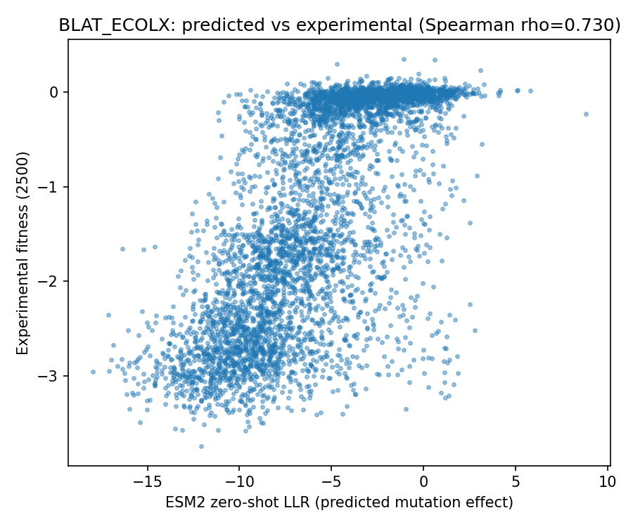
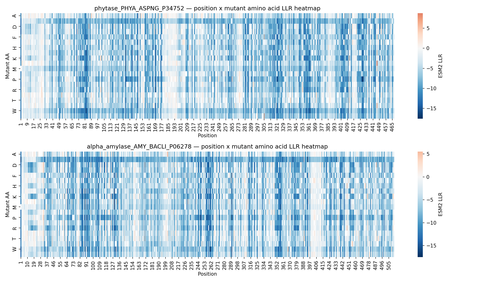

# Enzyme Variant Effect Prediction with ESM2

Zero-shot mutation effect prediction for industrial enzymes using the ESM2 protein language model. The pipeline is validated against published ProteinGym benchmarks, then applied to two industrial enzymes to screen variant candidates and to check that the model recovers known catalytic residues.

Everything here runs from the model weights directly, not through a web server. All results were produced on a single T4 GPU.


## Method

ESM2 (`facebook/esm2_t33_650M_UR50D`) scores the effect of point mutations on protein function **without any experimental data**, using the masked-marginal zero-shot scoring method from [Meier et al., 2021](https://doi.org/10.1101/2021.07.09.450648) ("Language models enable zero-shot prediction of the effects of mutations on protein function"):

1. Mask the mutated position in the wild-type sequence.
2. Get the model's predicted log-probability distribution over amino acids at that position.
3. Score = log P(mutant residue) − log P(wild-type residue). Higher score ⇒ the model considers the mutation more evolutionarily plausible (i.e., less likely to be deleterious).

**Performance optimization**: naively scoring one mutation at a time requires one forward pass per mutation (~5,000 forward passes for a full DMS dataset — 10+ hours on CPU). Since every mutation at a given position shares the same masked input, this was refactored to cache one forward pass per *position*, batched across positions — roughly a 19x reduction. `tests/test_offline.py` asserts that the batched implementation returns numerically identical scores to the naive one (max difference 0.000e+00), so the speedup does not trade away correctness.

## Benchmark validation

Two ProteinGym deep mutational scanning (DMS) assays, scored end-to-end by this pipeline and compared against the published ProteinGym zero-shot leaderboard for the same model:

| Assay | Protein | Mutants | This pipeline | ProteinGym ESM2-650M |
|---|---|---|---|---|
| BLAT_ECOLX (Ranganathan 2015) | TEM-1 β-lactamase (*E. coli*) | 4,996 | **ρ = 0.730** | 0.704–0.737 across BLAT assays |
| AMIE_PSEAE_Wrenbeck_2017 | Aliphatic amidase (*P. aeruginosa*) | 6,227 | **ρ = 0.557** | 0.557 |

Both land on the published numbers, the second on an enzyme family the pipeline was not developed against. Since this is the same model and method as the leaderboard entry, agreement is the expected outcome — the value of the check is that it confirms the implementation matches the published method rather than silently diverging from it.

<p align="center">
  
</p>

Any of the 217 ProteinGym substitution assays can be run the same way:

```bash
python scripts/proteingym_benchmark.py --dms-id AMIE_PSEAE_Wrenbeck_2017
```

The script resolves the assay metadata, verifies the mutation numbering against the reference sequence, checks the score direction before computing a correlation, scores the variants, and compares the result against the official leaderboard.

## Application to industrial enzymes

The validated pipeline was applied to two enzymes relevant to industrial biotech (fermentation / feed enzyme production):

| Enzyme | UniProt | Application |
|---|---|---|
| Phytase A (*A. niger*) | [P34752](https://www.uniprot.org/uniprotkb/P34752/entry) | Feed enzyme — improves phosphorus bioavailability in animal feed |
| Alpha-amylase / amyS (*B. licheniformis*) | [P06278](https://www.uniprot.org/uniprotkb/P06278/entry) | Starch liquefaction — food/fermentation industry standard enzyme |

For each enzyme, full saturation mutagenesis (every position × 19 substitutions; 8,873 and 9,728 variants respectively) was scored, then checked against UniProt functional annotations the model never sees:

| Enzyme | Active site mean LLR | Binding site mean LLR | Other positions mean LLR |
|---|---|---|---|
| Phytase A | −11.94 (His82) | −8.92 | −5.29 |
| Alpha-amylase | −13.33 (Asp260, Glu290) | −6.17 | −5.24 |

Both enzymes show the expected gradient — active site mutations scored most deleterious, binding site next, everything else least — confirming the model identifies functionally critical residues without being told which ones they are. For alpha-amylase, the annotated active-site residues (Asp260/Glu290, UniProt precursor numbering) correspond to the literature-known catalytic triad (Asp-Glu-Asp) of GH13-family amylases.

<p align="center">
  
</p>

Top-ranked candidate variants are saved per enzyme as CSVs for downstream hypothesis generation.

## Limitations

- Zero-shot LLR is a proxy for evolutionary plausibility / stability, **not** a direct measurement of catalytic activity or substrate specificity. Top-ranked candidates are hypotheses for further (wet-lab or higher-fidelity computational) validation, not confirmed improvements.
- Properties that matter under industrial process conditions — thermostability, pH tolerance, solvent tolerance — are not directly represented by this score.
- The two industrial enzymes have no paired DMS dataset, so their predictions are checked for biological plausibility (active-site recovery) rather than validated against measured fitness.

## Future work

- **Structure prediction**: comparing predicted 3D structure and confidence of wild-type vs. top-ranked variants with [Boltz-2](https://github.com/jwohlwend/boltz) (open-source, MIT), an AlphaFold3-class model that also predicts ligand binding affinity. A notebook is drafted in `boltz2_structure_extension.ipynb`.
- Baseline comparison (BLOSUM62, random) to quantify how much of the correlation is attributable to the language model.
- Additional ProteinGym assays to widen the validation set.

## Repo contents

- `esm2_enzyme_variant_effect_miniproject.ipynb` — main pipeline: benchmark validation + industrial enzyme saturation mutagenesis
- `scripts/proteingym_benchmark.py` — run any ProteinGym substitution assay end-to-end (`--dms-id <id>`), with automatic comparison against the published leaderboard
- `tests/test_offline.py` — validation that needs no GPU and no model download, including the numerical equivalence check between batched and naive scoring
- `boltz2_structure_extension.ipynb` — structure prediction extension (drafted)
- `BLAT_ECOLX_reference_with_esm1v_scores.csv` — reference DMS dataset + published ESM1v scores. Redistributed from [facebookresearch/esm](https://github.com/facebookresearch/esm) (MIT licence); the underlying deep mutational scan is from Firnberg/Stiffler et al., TEM-1 β-lactamase (2014–2015).
- `results/` — ProteinGym benchmark outputs (scored variants, correlation plot, cumulative `benchmark_summary.csv`)
- `phase2_*_saturation_mutagenesis.csv` — per-enzyme saturation mutagenesis results
- `phase1_blat_ecolx_correlation.png`, `phase2_heatmaps.png` — result figures

## References

- Meier et al., 2021. [Language models enable zero-shot prediction of the effects of mutations on protein function](https://doi.org/10.1101/2021.07.09.450648). bioRxiv.
- Lin et al., 2023. Evolutionary-scale prediction of atomic-level protein structure with a language model (ESM2). *Science*.
- Notin et al., 2023. [ProteinGym: Large-Scale Benchmarks for Protein Fitness Prediction and Design](https://proteingym.org). NeurIPS.
- Wrenbeck et al., 2017. Single-mutation fitness landscapes for an enzyme on multiple substrates reveal specificity is globally encoded. *Nature Communications*.
- Passaro et al., 2025. [Boltz-2: Towards Accurate and Efficient Binding Affinity Prediction](https://github.com/jwohlwend/boltz).
